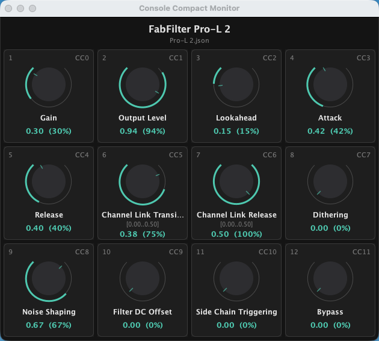

# Bitwig Compact

A mapping system for using the **Softube Console 1 Compact** with Bitwig Studio. It turns the
console's 12 equalizer-section knobs into a control surface for **any Bitwig device — native
devices and VST3 plugins**.

Each knob targets a plugin parameter **by name** through Bitwig's Controller Scripting API
(Java extension API with direct-parameter access). Mappings live in one JSON file per plugin:
select a device in Bitwig and the knob position displays snap to the plugin's current state;
turn a knob and the mapped parameter moves. Extras: per-knob range scaling, a parameter-name
dump for authoring configs, and an always-on-top monitor window showing every knob, its
parameter and live position.

## Requirement

The **Softube Console 1 channel strip VST3 must be present on every track** you want to
control — the console's integration is tied to it, and tracks without the channel strip won't
respond to the knobs.

## Hardware setup

In the Softube Console 1 app, set the **Equalizer section to CC 0–25**. The 12 knobs then send
fixed MIDI CCs (configured in `maps/console-compact.json`, currently CC 0–11 on channel 1).
The CC numbers never change afterwards.

## Layout

| Path | What |
|---|---|
| `shell/` | Pure-Java core (**no Bitwig dependencies**): event model, JSON config, mapping logic with range scaling, CLI test harness |
| `extension/` | The `.bwextension` Bitwig loads; thin adapter hosting the shell inside Bitwig's Controller API |
| `monitor/` | Always-on-top window app (UDP-fed) showing knobs, parameters and live positions |
| `maps/` | Default maps: `console-compact.json` (hardware: channel + fixed CCs) and `devices/*.json` (per-plugin knob → parameter mappings) |
| `BitwigCompact.bwextension` | Prebuilt extension, ready to copy into Bitwig (see Installation) |
| `Console Compact Monitor.app` | Double-clickable macOS launcher for the monitor window |

## Events (the shell's contract)

In (`ShellInput`): `deviceSelected(name)`, `parameterValueChanged(name, normalized)`, `midiReceived(status, d1, d2)`
Out (`ShellOutput`): `sendMidi(status, d1, d2)` (CC → knob displays), `setParameter(name, normalized)`, `log(msg)`

## Installation

1. Copy **`BitwigCompact.bwextension`** (repository root) to
   `~/Documents/Bitwig Studio/Extensions/` — create the folder if it doesn't exist.
2. Restart Bitwig → Settings → Controllers → Add Controller → *George Hill / BitwigCompact*,
   set input/output to the Console Compact's MIDI ports.
3. Copy the default maps into your config folder:
   `cp -R maps/. "$HOME/Documents/Bitwig Studio/BitwigCompact/"`

Or build from source with `./build.sh` (runs the tests, installs the extension into
Bitwig's Extensions folder and refreshes the exported copy in the repository root).

## Settings

The controller exposes one setting in Bitwig (Settings → Controllers → BitwigCompact):

- **Config folder** — the folder the extension reads maps from and writes
  `last-device-params.txt` to. Changing it rebuilds the mapping immediately (the current
  device selection is re-applied, no restart needed).

Default: on the machine where the extension was built, the repository's `maps/` folder
(its path is embedded at build time and only used when it exists); everywhere else
`~/Documents/Bitwig Studio/BitwigCompact`. The `consolecompact.config.dir` system property
overrides the default.

## Build & install

```bash
./build.sh          # = JAVA_HOME=/opt/homebrew/opt/openjdk mvn clean install
                    # runs tests, then copies BitwigCompact.bwextension into
                    # ~/Documents/Bitwig Studio/Extensions/ and the repository root
```

Note: Java is not on the default PATH on this machine — either
`export PATH="/opt/homebrew/opt/openjdk/bin:$PATH"` or use `/opt/homebrew/opt/openjdk/bin/java`
instead of plain `java` in the commands below.

## Configure

1. Hardware CCs: with the Softube app's Equalizer section set to CC 0–25, verify the CCs your
   knobs actually send with `java -jar shell/target/console-compact-shell-*-standalone.jar
   --hardware "Console"` (or `--list-ports`), then adjust `maps/console-compact.json` if
   needed.
2. Per plugin: copy `maps/devices/_template.json` to `<DeviceName>.json`, list the parameter
   names exactly as Bitwig reports them (select the device once, then read the parameter dump,
   below). A knob can be a plain name (full 0–1 range) or `{"param": "Name", "range": [a, b]}`
   where `a`/`b` are the parameter values at CC 0 / CC 127 — e.g. `[0, 0.5]` spreads the knob's
   full travel over the first half of the parameter, `[1, 0]` inverts the knob.
   Configs are re-read on every device selection — no Bitwig restart needed.
3. The config folder is a controller setting (see Settings); maps live in `maps/` in the
   repository by default on the build machine, or `~/Documents/Bitwig Studio/BitwigCompact`
   elsewhere.

## Example device config

`maps/devices/Pro-L 2.json` (abbreviated) — plain names map the knob's full travel to the
parameter's full range; the object form scales the travel to a sub-range:

```json
{
  "match": ["Pro-L 2"],
  "knobs": {
    "1": "Gain",
    "2": "Output Level",
    "3": "Lookahead",
    "4": "Attack",
    "5": "Release",
    "6": { "param": "Channel Link Transients", "range": [0.0, 0.5] },
    "7": { "param": "Channel Link Release", "range": [0.0, 0.5] },
    "12": "Bypass"
  }
}
```

Parameter names come straight from the parameter dump (below) — no guessing.

## Parameter dump (config authoring)

Selecting a device in Bitwig writes `last-device-params.txt` into the active config folder
(the repository's `maps/` on the build machine, `~/Documents/Bitwig Studio/BitwigCompact`
elsewhere): every parameter of the selected plugin, in plugin order, with current values and
ids. Use it to fill in `devices/*.json` (re-select the device afterwards to hot-reload).
Override the location with `-Dconsolecompact.dump.dir=<path>`.

## Monitor window

An always-on-top window showing the 12 knobs, their mapped parameter names, live values and a
drawn dial per knob. It listens on UDP localhost:51234 and is fed by both the Bitwig extension
and the simulator.



**One-click:** double-click **`Console Compact Monitor.app`** in the repository root (Finder),
or drag it into the Dock. It launches the newest built jar automatically; if the jar is missing
(fresh clone), it notifies you to run `./build.sh` first.

Command line equivalent:

```bash
/opt/homebrew/opt/openjdk/bin/java -jar monitor/target/console-compact-monitor-0.2.jar
```

Start it, then (re-)select a device to get the full snapshot. Optional first CLI arg overrides
the port; the shell side broadcasts to `-Dconsolecompact.monitor.port` (0 disables).

## Test without Bitwig / hardware

```bash
java -jar shell/target/console-compact-shell-*-standalone.jar --simulate --config maps
> device FabFilter Pro-L 2
> cc 0 100          # pretend knob 1 (CC 0) turned
> value Release 0.5 # pretend Bitwig reported a value
```

(From the repository root, `--config maps` is the default and can be omitted.)

## In Bitwig

Settings → Controllers → Add Controller → *George Hill / BitwigCompact*,
set input/output to the Console Compact's MIDI ports. Log output: Controllers → Show Log.

## Known caveats

- Direct parameter access targets **plugins** (VST3/CLAP). Built-in devices (e.g. Compressor)
  may not report direct parameters — the extension logs "device parameters: 0" in that case.
- If knob LED/position displays do not update from CC-out, verify with the standalone
  `--hardware` mode.
- MIDI port auto-detection is not filled in yet (`listAutoDetectionMidiPortNames` TODO).
